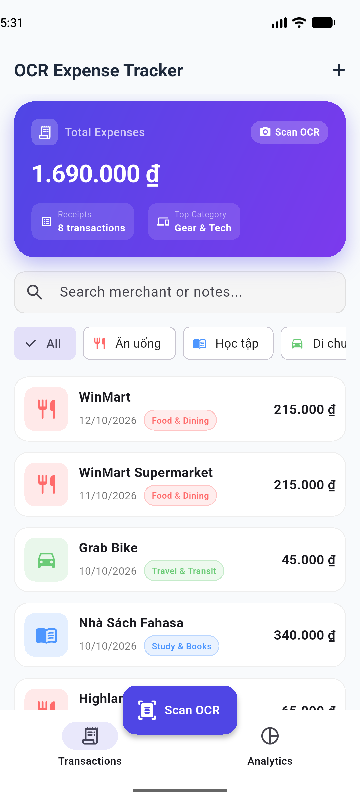
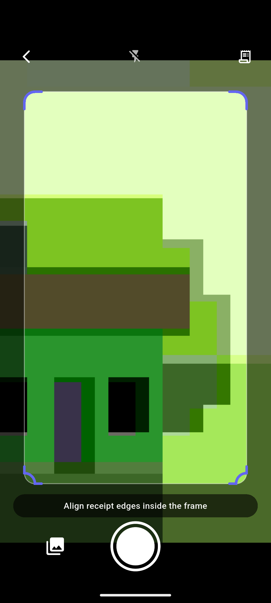
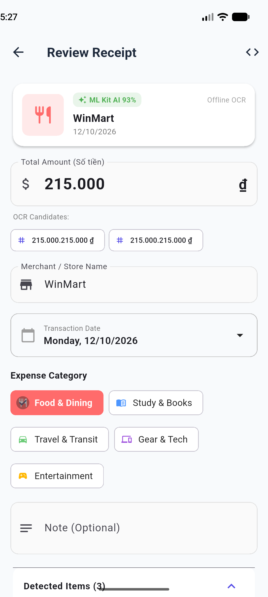
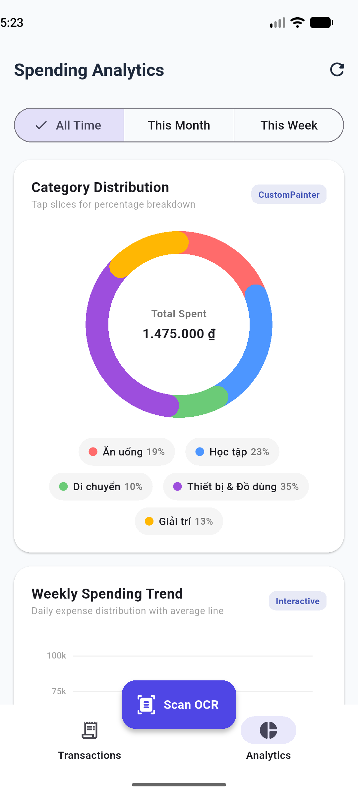
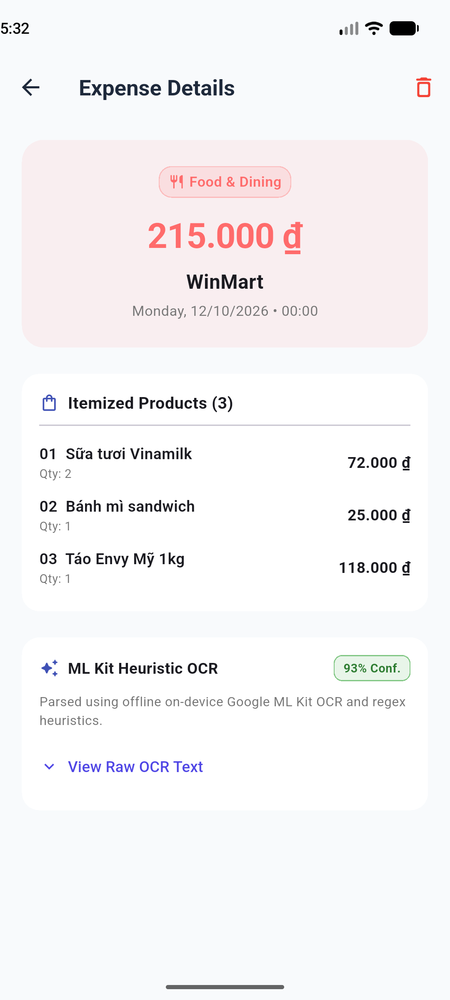

# MINI-PROJECT SHORT TECHNICAL REPORT
**Course:** Cross-Platform Mobile App Development (VKU)  
**Mini-Project Title:** Mini-Project 3: OCR Expense Tracker & Receipt Parser (Flutter & Dart)  
**Student Name:** [Họ và tên sinh viên]  
**Submission Date:** [DD/MM/YYYY]  

---

## 1. GENERAL INFORMATION & DELIVERABLE LINKS
* **Student Information (Cá nhân thực hiện):**
  1. **[Họ và tên sinh viên]** — Student ID: **[22ITxxx]** — Class: **[22ITx]** — Role: Fullstack Mobile Development (UI/UX, OCR Engine, CustomPainter, SQLite Database, CI/CD) — Contribution: 100%
* **🔗 Release APK Download:** [`build/app/outputs/flutter-apk/app-release.apk`](build/app/outputs/flutter-apk/app-release.apk)
* **💻 GitHub Repository:** `https://github.com/[username]/[your-repo-name]`

---

## 2. FEATURE IMPLEMENTATION CHECKLIST

| # | Required Feature | Status | Implementation Details & Acceptance Level |
|:---:|---|:---:|---|
| **1** | **Camera Capture & Image Cropping** | ✅ Complete | • Live camera viewfinder 60fps sử dụng CameraX (`camera: ^0.12.1`).<br>• Chuyển đổi Flash đa chế độ (Auto, Off, Torch).<br>• Chạm lấy nét đa điểm (`setFocusPoint`) kèm hiệu ứng vòng tròn tiêu cự màu cam sinh động.<br>• Lớp phủ căn chỉnh hóa đơn chuẩn 4 góc bracket bo tròn (`FramingCropOverlay`), hỗ trợ chọn ảnh từ thư viện hoặc nạp hóa đơn mẫu thử nghiệm tức thì. |
| **2** | **On-Device Text Recognition & Regex Heuristics** | ✅ Complete | • Nhận diện văn bản hoàn toàn ngoại tuyến (offline, sub-100ms, 0đ chi phí cloud) qua Google ML Kit (`google_mlkit_text_recognition`).<br>• Bộ máy Heuristic Regex tiếng Việt & quốc tế trích xuất tự động: Tổng tiền (`215.000 đ`, `150,000 VND`, `150k`), Ngày giao dịch (`DD/MM/YYYY`), Tên thương hiệu (WinMart, Highlands, Fahasa, Grab, CellphoneS...).<br>• Bộ lọc từ khóa phủ định (Negative Keywords) loại trừ hoàn toàn việc nhầm lẫn giữa tổng tiền với tiền thối/tiền thừa/tiền khách đưa.<br>• Màn hình Review tương tác cho phép chỉnh sửa trước khi lưu, hiển thị điểm tin cậy AI và chip gợi ý các con số OCR ứng viên. |
| **3** | **Local Database & Transaction Lifecycle** | ✅ Complete | • Lưu trữ bền vững với SQLite (`sqflite`), đánh index tại cột `date` và `category` nhằm tối ưu hóa truy vấn biểu đồ.<br>• Hỗ trợ đầy đủ vòng đời CRUD (Thêm, Đọc, Sửa, Vuốt để xóa có hộp thoại xác nhận).<br>• Phân loại 5 nhóm chi tiêu chuẩn: **Food & Dining**, **Study & Books**, **Travel & Transit**, **Gear & Tech**, **Entertainment**.<br>• Tự động nén và cache ảnh hóa đơn gốc & thumbnail vào bộ nhớ ứng dụng nội bộ (`ThumbnailService`). |
| **4** | **Custom Canvas Visualizations with CustomPainter** | ✅ Complete | • **Tuyệt đối tuân thủ yêu cầu đề bài: KHÔNG sử dụng bất kỳ thư viện biểu đồ bên thứ ba nào** (`fl_chart`, `syncfusion`...). Toàn bộ được vẽ bằng pure Dart Canvas API.<br>• **Animated Donut Chart**: Vẽ cung quét động với `Curves.easeOutCubic`, bo tròn đầu cung (`StrokeCap.round`), hỗ trợ toán lượng giác `atan2` bắt sự kiện chạm (hit-testing) để bung lát cắt (exploded slice) và hiển thị thông tin ở tâm.<br>• **Animated Bar Chart**: Cột chi tiêu 7 ngày trong tuần mọc từ 0, đường kẻ trung bình ngày (Average Line) và Tooltip tương tác vẽ trực tiếp trên Canvas khi chạm/kéo tay. |

---

## 3. TECHNICAL ARCHITECTURE & PROJECT STRUCTURE

### 3.1. Directory Structure (Cấu trúc thư mục)
```
lib/
├── main.dart                          # Khởi tạo Flutter Engine, nạp SQLite, cấu hình Theme Material 3
├── models/
│   ├── category.dart                  # Enum 5 danh mục chi tiêu, icon, bảng màu, tên hiển thị
│   ├── expense.dart                   # Thực thể ExpenseItem & SQLite serialization (toMap / fromMap)
│   └── parsed_receipt.dart            # Dữ liệu bóc tách từ OCR: merchant, amount, date, confidence, lineItems
├── services/
│   ├── database_helper.dart           # SQLite Helper: Quản lý kết nối, CRUD, nạp dữ liệu mẫu ban đầu
│   ├── ocr_service.dart               # Tích hợp Google ML Kit Text Recognition on-device
│   ├── receipt_heuristic_parser.dart  # Bộ máy Regex Heuristic tiếng Việt & từ điển chuỗi cửa hàng
│   └── thumbnail_service.dart         # Nén ảnh hóa đơn gốc và tạo thumbnail lưu vào app sandbox
├── widgets/
│   ├── animated_donut_chart.dart      # CustomPainter biểu đồ tròn quét góc & tương tác bung lát cắt
│   ├── animated_bar_chart.dart        # CustomPainter biểu đồ cột tuần, vạch trung bình & canvas tooltip
│   ├── framing_crop_overlay.dart      # CustomPainter khung ngắm kính scanner 4 góc bo tròn
│   ├── expense_list_tile.dart         # Thẻ hiển thị giao dịch kèm thao tác Dismissible vuốt để xóa
│   ├── summary_card.dart              # Thẻ banner tổng quan số dư chi tiêu gradient tím
│   └── category_badge.dart            # Chip huy hiệu hiển thị danh mục
├── screens/
│   ├── home_screen.dart               # Trang chủ: Danh sách chi tiêu, tìm kiếm, lọc danh mục, BottomNav
│   ├── camera_screen.dart             # Kính ngắm Camera trực tiếp, lấy nét cảm ứng, bật tắt đèn Flash
│   ├── receipt_review_screen.dart     # Kiểm tra kết quả OCR, điều chỉnh số tiền, chọn candidate chips
│   ├── analytics_screen.dart          # Dashboard phân tích tài chính với 2 biểu đồ CustomPainter
│   └── expense_detail_screen.dart     # Chi tiết hóa đơn, xem ảnh chụp phóng to và chẩn đoán OCR raw
├── theme/
│   └── app_theme.dart                 # Định nghĩa theme Material 3 hiện đại, bảng màu trực quan
└── utils/
    └── currency_formatter.dart        # Định dạng tiền tệ VND (150.000 ₫), rút gọn (150k, 1.5M) & parser chuỗi
```

### 3.2. State Management & Data Flow (Luồng dữ liệu)
```
[Camera / Gallery / Mock]
         │
         ▼
[Google ML Kit Text Recognition]  ──(Sub-100ms On-Device OCR)──►  [Raw Recognized Text]
                                                                            │
                                                                            ▼
                                                            [ReceiptHeuristicParser]
                                                            ├── Regex Match Amounts (VND)
                                                            ├── Exclude Negative Keywords (Tiền thối)
                                                            ├── Regex Match Dates (DD/MM/YYYY)
                                                            └── Brand Dictionary Categorization
                                                                            │
                                                                            ▼
[SQLite Storage (sqflite)]  ◄───[User Edits / Saves]────  [ReceiptReviewScreen]
         │
         ├──► [HomeScreen: SliverList, Search & Category Filters]
         └──► [AnalyticsScreen: Pure Dart CustomPainter Canvas Charts]
```

---

## 4. EMPIRICAL EVIDENCE & SCREENSHOTS

Dưới đây là các ảnh chụp thực tế từ ứng dụng đang chạy trực tiếp trên máy ảo Android **Google Pixel 7 (API 34)**:

| 1. Trang chủ & Danh sách giao dịch | 2. Kính ngắm Camera & Lấy nét |
|:---:|:---:|
|  |  |
| *Giao diện Material 3 với thẻ tổng quan, bộ lọc danh mục và danh sách chi tiêu từ SQLite.* | *Kính ngắm camera thời gian thực với khung crop viền xanh và reticle lấy nét cảm ứng.* |

| 3. Màn hình Xem lại & Sửa OCR | 4. Phân tích tài chính (CustomPainter) |
|:---:|:---:|
|  |  |
| *Bóc tách tự động hóa đơn WinMart (215.000 ₫), danh sách mặt hàng và độ tin cậy AI 93%.* | *Biểu đồ Donut bung lát cắt khi chạm và Biểu đồ cột 7 ngày vẽ 100% bằng CustomPainter.* |

| 5. Chi tiết giao dịch & Bóc tách sản phẩm |
|:---:|
|  |
| *Chi tiết hóa đơn với danh sách từng món hàng đã mua, số lượng và chẩn đoán OCR.* |

---

## 5. TECHNICAL CHALLENGES & RESOLUTIONS

### Thách thức 1: Xung đột Gradle 9 Kotlin DSL & Bộ đệm biên dịch chéo ổ đĩa trên Windows
* **Vấn đề:** Môi trường Flutter 3.47 sử dụng Gradle 9 với định dạng mới `.gradle.kts`, dẫn đến lỗi `Plugin [id: 'com.android.application'] was not found`. Thêm vào đó, project nằm ở ổ `D:\` trong khi Gradle Cache ở ổ `C:\` gây ra lỗi `IllegalArgumentException: this and base files have different roots` trong bộ biên dịch Kotlin Incremental.
* **Giải pháp:** 
  1. Chuyển đổi và chuẩn hóa toàn bộ file cấu hình Gradle sang Kotlin DSL (`settings.gradle.kts`, `build.gradle.kts`, `app/build.gradle.kts`).
  2. Bổ sung cấu hình `kotlin.incremental=false` và `kotlin.incremental.useClasspathSnapshot=false` trong `android/gradle.properties` để loại trừ hoàn toàn xung đột đường dẫn chéo ổ đĩa.

### Thách thức 2: Lỗi R8 ProGuard Missing Classes khi đóng gói Release APK với Google ML Kit
* **Vấn đề:** Khi build bản phát hành `assembleRelease`, trình tối ưu hóa mã R8 báo lỗi thiếu các lớp ngôn ngữ tùy chọn của ML Kit (`ChineseTextRecognizerOptions`, `DevanagariTextRecognizerOptions`, `JapaneseTextRecognizerOptions`, `KoreanTextRecognizerOptions`) do plugin khai báo reflection nhưng app chỉ cần bảng chữ cái Latin.
* **Giải pháp:** Tạo tệp cấu hình ProGuard chuyên dụng tại `android/app/proguard-rules.pro` với các quy tắc `-dontwarn com.google.mlkit.vision.text.**` và kích hoạt trong `buildTypes.release` của file Gradle, giúp ứng dụng đóng gói thành công bản Release siêu nhẹ (chỉ ~32 MB).

### Thách thức 3: Hiện thực biểu đồ tương tác cao hoàn toàn bằng `CustomPainter` (Zero 3rd-Party)
* **Vấn đề:** Không được dùng các thư viện có sẵn (`fl_chart`, `charts_flutter`), đòi hỏi phải tự tính toán hình học không gian, góc lượng giác và xử lý va chạm cảm ứng ngay trên Canvas.
* **Giải pháp:**
  1. **Donut Chart**: Sử dụng hàm `canvas.drawArc` với đường cong hoạt họa `easeOutCubic`. Bắt tọa độ chạm `(dx, dy)` và chuyển đổi sang tọa độ cực bằng `atan2(dy - centerY, dx - centerX)` để xác định chính xác múi được click, từ đó dịch chuyển tâm lát cắt ra ngoài một khoảng vector `Offset(cos(midAngle) * 8, sin(midAngle) * 8)`.
  2. **Bar Chart**: Tính toán tỉ lệ chiều cao cột dựa trên giá trị lớn nhất trong tuần, vẽ đường đứt nét trung bình bằng chu kỳ `dashWidth`/`dashSpace`, và render tooltip màu đen nổi bật ngay trên đỉnh cột khi người dùng di chuyển ngón tay.

---

## 6. PROJECT SETUP & EXECUTION GUIDE (HƯỚNG DẪN CÀI ĐẶT & KHỞI CHẠY)

### 6.1. Yêu cầu môi trường (Prerequisites)
- **Flutter SDK:** Phiên bản `>= 3.10.0` (Đã kiểm thử tối ưu trên Flutter 3.47.7 & Dart 3.13.5).
- **Android Studio / VS Code** đã cài Flutter Extension.
- **Android SDK:** `compileSdkVersion 34`, `minSdkVersion 21`.
- **Thiết bị chạy:** Thiết bị thật Android (kết nối qua USB Debugging) hoặc Máy ảo Android (Android Emulator với Camera Virtual Scene).

### 6.2. Các bước cài đặt chi tiết

1. **Clone repository về máy tính:**
   ```bash
   git clone https://github.com/[username]/[your-repo-name].git
   cd [your-repo-name]
   ```

2. **Cài đặt các gói phụ thuộc (Dependencies):**
   ```bash
   flutter pub get
   ```

3. **Chạy bộ kiểm thử tự động (Unit Tests):**
   ```bash
   flutter test
   ```
   *Kết quả mong đợi: `All tests passed! (7/7 tests pass)`*

4. **Khởi chạy ứng dụng (Debug Mode):**
   - Đảm bảo đã mở máy ảo hoặc cắm điện thoại Android vào máy tính:
     ```bash
     flutter devices
     ```
   - Chạy ứng dụng:
     ```bash
     flutter run
     ```
   - Trong quá trình chạy, bạn có thể bấm phím `r` để Hot Reload hoặc `R` để Hot Restart.

5. **Đóng gói file cài đặt APK (Release APK):**
   - Build file APK Universal (cài được trên mọi điện thoại Android):
     ```bash
     flutter build apk
     ```
     *File tạo thành tại: `build/app/outputs/flutter-apk/app-release.apk`*
   - Hoặc build file APK tối ưu dung lượng (chỉ ~32MB cho máy hiện đại):
     ```bash
     flutter build apk --split-per-abi
     ```
     *File tạo thành tại: `build/app/outputs/flutter-apk/app-arm64-v8a-release.apk`*

### 6.3. Hướng dẫn thử nghiệm nhanh các tính năng (Demo Guide)
1. **Quét hóa đơn mẫu (Không cần hóa đơn giấy thật):**
   - Mở app -> Chọn nút **"Scan OCR"** ở giữa thanh điều hướng dưới cùng.
   - Nhấn vào biểu tượng hóa đơn ở góc trên cùng bên phải màn hình camera.
   - Chọn một trong các mẫu:
     - 🛒 **WinMart Supermarket**: Tự động bóc tách 215.000 ₫, phân loại `Food & Dining`, phát hiện 3 sản phẩm, loại trừ tiền thừa 285.000 ₫.
     - ☕ **Highlands Coffee**: Tự động bóc tách 149.000 ₫, loại trừ tiền thối 51.000 ₫.
     - 📚 **Fahasa Bookstore**: Tự động bóc tách 290.000 ₫, phân loại `Study & Books`.
     - 🛵 **GrabBike Commute**: Tự động bóc tách 45.000 ₫, phân loại `Travel & Transit`.
2. **Quét hóa đơn giấy thật:**
   - Đưa hóa đơn vào khung kính ngắm `FramingCropOverlay`.
   - Chạm vào dòng chữ trên hóa đơn để tự động lấy nét hoặc bật đèn Flash nếu thiếu sáng.
   - Bấm nút chụp hình tròn màu trắng -> Trí tuệ nhân tạo ML Kit sẽ xử lý tức thì (< 100ms).
3. **Trải nghiệm biểu đồ CustomPainter:**
   - Chuyển sang tab **"Analytics"**.
   - Chạm vào từng múi biểu đồ Donut để xem hiệu ứng bung lát cắt và số tiền tương ứng.
   - Chạm/vuốt ngón tay trên biểu đồ cột 7 ngày để xem Tooltip hiển thị số tiền chính xác trên Canvas.
